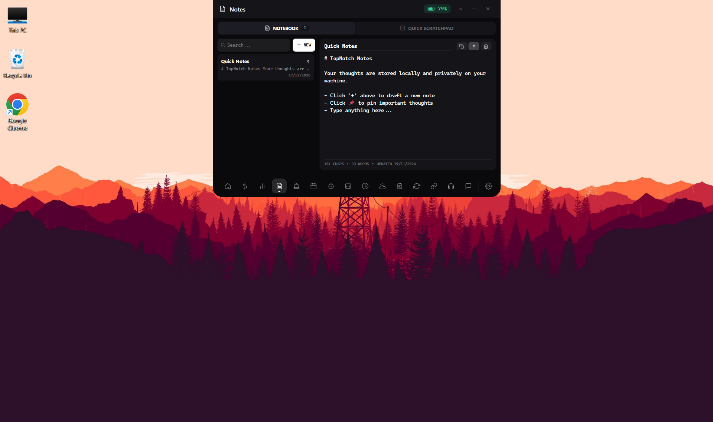
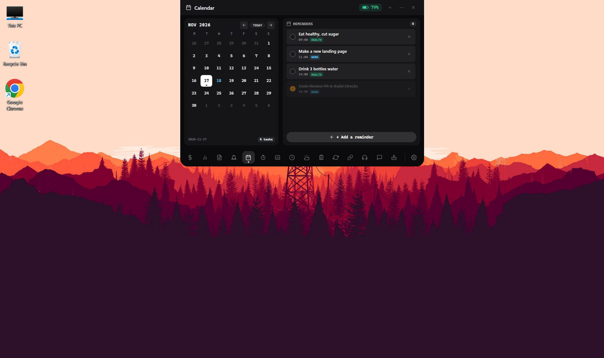

  
  <h1 style="margin-top: 12px; margin-bottom: 4px;">Orbit Notch</h1>
  
<b>The Floating Utility Notch & Universal Quick-Access HUD for Windows</b>

  

    
    
    
    
  

  

    <a href="https://apps.microsoft.com/detail/9NT7MW2M4R45"><b>Get on Microsoft Store</b></a> &nbsp;•&nbsp;
    <a href="https://orbit-notch.vercel.app/"><b>Official Website</b></a> &nbsp;•&nbsp;
    <a href="#-downloads"><b>Downloads</b></a> &nbsp;•&nbsp;
    <a href="#-features"><b>Features</b></a> &nbsp;•&nbsp;
    <a href="#-shortcuts"><b>Shortcuts</b></a> &nbsp;•&nbsp;
    <a href="PRIVACY.md"><b>Privacy Policy</b></a>
  

---

## ⚡ What is Orbit Notch?

**Orbit Notch** is an ultra-fast, minimalist floating utility notch and dynamic HUD designed natively for Windows 11 and Windows 10. Built from the ground up with high-performance native Rust and modern Svelte 5, it sits lightly at the top of your screen to elevate your daily workflow without stealing focus or cluttering your screen.

Resting discreetly at the top bezel of your display as an unobtrusive 36px hardware-style digital clock, Orbit Notch expands with smooth spring physics whenever you copy text, grab a screenshot, play music, or drag files. With a single click or keyboard shortcut (<kbd>Ctrl</kbd> + <kbd>Space</kbd> or <kbd>Alt</kbd> + <kbd>\</kbd>), it blooms into a productivity dashboard, Fluent Control Center with live brightness and volume sliders, Bluetooth battery indicators, real-time network throughput, and an offline image converter.

---

## 📸 Desktop Previews

  
  
<i><b>Home & Fluent Control Center</b>: Display brightness and sound sliders, Bluetooth battery indicators, live network throughput (↓↑), and system vitals.</i>

   
  
  
<i><b>Resting Dynamic Notch</b>: Minimalist 36px live clock docked seamlessly to the top bezel.</i>

   
  
  
<i><b>Quick Notes & Markdown Notebook</b>: Always-ready distraction-free notes stored in local SQLite.</i>

   
  
  
<i><b>LED Dot-Matrix Marquee</b>: 64×16 OLED text banners streaming across the collapsed notch.</i>

   
  
  
<i><b>Calendar & Reminders</b>: Monthly deadlines, meeting checklists, and hydration nudges.</i>

---

## 📥 Downloads

Choose your preferred way to install:

| Method | Type | Best For | Link |
| :--- | :--- | :--- | :--- |
| **Microsoft Store** | Official Store App | Automatic background updates & verified security | [**Get from Microsoft Store**](https://apps.microsoft.com/detail/9NT7MW2M4R45) |
| **Windows Package Manager** | `winget` | Command-line quick install | `winget install orbitnotch` |
| **Direct MSIX Package** | `.msix` Container (v0.2.3.0) | Sideload & Enterprise deployment | [**Download OrbitNotch.msix (Releases)**](https://github.com/Kaifazad/Orbit-Notch/releases) |
| **Portable x64 Bundle** | `.zip` Archive (v0.2.3) | Portable standalone run | [**Download Windows x64 (.zip)**](https://github.com/Kaifazad/Orbit-Notch/releases) |

> **System Requirements**: Windows 11 or Windows 10 (64-bit). No administrator elevation required (`asInvoker`).

---

## 🌟 Key Features

### ⏱️ 1. Clean Live Clock Default
- Quietly sits docked at the top bezel showing time in 12h or 24h format.
- Instant, non-intrusive notification pill for clipboard activity, song changes, or timer alerts.
- Smart content recognition:
  - 📋 **Code & Text**: Live snippet preview with character count and domain tags.
  - 🖼️ **Images & Screenshots**: Rich thumbnail badges.
  - 📁 **Files & Folders**: Quick item count and filesystem path confirmation chips.
  - 🎵 **Media Playback**: Live equalizer bars and track titles via GSMTC.

### 🎛️ 2. Fluent Control Center & Hardware Telemetry
- **Hardware Sliders**: Smooth, non-blocking Display Brightness and Master Volume controls.
- **Bluetooth Quick Manager**: Live earbud/headphone battery indicators (e.g. AirPods, Galaxy Buds).
- **Network Throughput**: Real-time download and upload speed meters powered by Win32 `IPHLPAPI`.
- **System Telemetry & Temperatures**: CPU load, RAM utilization, one-click RAM Trim, and zero-driver system/GPU temperatures (`°C` / `°F`).

### 🗄️ 3. Universal Parking Shelf & Offline Converter
- **Drag & Drop Anything**: Drag images, files, or text from web browsers, File Explorer, or your desktop directly onto the notch to park them.
- **Offline Image Converter**: Convert images between WebP, PNG, JPEG, ICO, and PDF with 100% offline local processing.
- **Clipboard Parking (`Ctrl + V`)**: Press <kbd>Ctrl+V</kbd> while the shelf is open to instantly store clipboard items.

### 🎯 4. Free Screen Placement & Drag-to-Reposition
- Grab and drag the **minimized pill**—or the **top header bar** when expanded—anywhere horizontally along the top bezel or freely anywhere on your screen (`X + Y`).
- Automatically switches to a floating capsule off-edge and opens upward near the bottom of your display so panels never clip.

### ⏱️ 5. Focus Timers & Pomodoro
- **Millisecond Stopwatch**: Instant split lap recording.
- **Pomodoro Focus Arc**: Visual 25/5 focus cycles built directly into the notch.
- **Quick Presets**: 5m, 15m, 30m, and 60m countdown timers for meetings and deep work.
- **Hydration Reminders**: Periodic gentle nudges to keep you hydrated throughout the day.

### 🎵 6. Relaxing Ambient Soundscapes
- Built-in sound engine: Rain, Thunder, Ocean Waves, White Noise, Campfire, Forest Birds, Coffee Shop, Stream, Wind, and Lo-Fi.
- Independent volume sliders and sleep timer.

### 🔒 7. 100% Private, Local-First & Safe
- **Zero Telemetry**: We do not collect, track, or sell your data.
- **No External Servers**: All notes, settings, and parked files remain 100% on your local disk in SQLite.
- **Safe Execution**: Runs as standard user mode (`asInvoker`). Never requests administrative elevation.
- **Optional Windows Startup**: Easily toggle automatic launch on Windows boot from Settings.

---

## ⌨️ Shortcuts

| Shortcut | Action |
| :--- | :--- |
| <kbd>Ctrl</kbd> + <kbd>Space</kbd> | Toggle Orbit Notch Shelf & Control Center |
| <kbd>Alt</kbd> + <kbd>\</kbd> | Alternative Quick Flyout Toggle |
| <kbd>Alt</kbd> + <kbd>P</kbd> | Quick Pomodoro Focus Timer |
| <kbd>Alt</kbd> + <kbd>B</kbd> | Quick Bookmarks / Battery Info |
| <kbd>Esc</kbd> | Collapse Flyout back into resting notch |

---

## ❓ Frequently Asked Questions (FAQ)

<b>Is Orbit Notch free to use?</b>

Yes! Orbit Notch is free to download and use for both personal and commercial productivity.

<b>Does Orbit Notch track my clipboard or files?</b>

No. Orbit Notch is strictly offline-first. Clipboard content and parked files are processed exclusively in your computer's local memory and private local storage. Zero data leaves your machine. See our <a href="PRIVACY.md">Privacy Policy</a>.

<b>How do I move the notch anywhere on my screen?</b>

Hover over the minimized pill (or the top header bar when expanded) until the cursor turns into a grab hand, then click and drag it freely anywhere along the top edge or across your screen. You can also choose Top Left / Top Center / Top Right presets or reset position inside <b>Settings → Screen & Alignment</b>.

<b>Can I launch Orbit Notch automatically when my PC starts?</b>

Yes! Open Orbit Notch Settings (<kbd>Ctrl</kbd> + <kbd>Space</kbd> &rarr; Gear icon) and enable "Launch on Windows Startup".

---

## 📄 License & Contact

- **Website**: [https://orbit-notch.vercel.app/](https://orbit-notch.vercel.app/)
- **Microsoft Store**: [https://apps.microsoft.com/detail/9NT7MW2M4R45](https://apps.microsoft.com/detail/9NT7MW2M4R45)
- **Privacy Policy**: Read our [Privacy Policy](PRIVACY.md).
- **Developer**: Kaif Azad ([itzkaifazad@gmail.com](mailto:itzkaifazad@gmail.com)).
