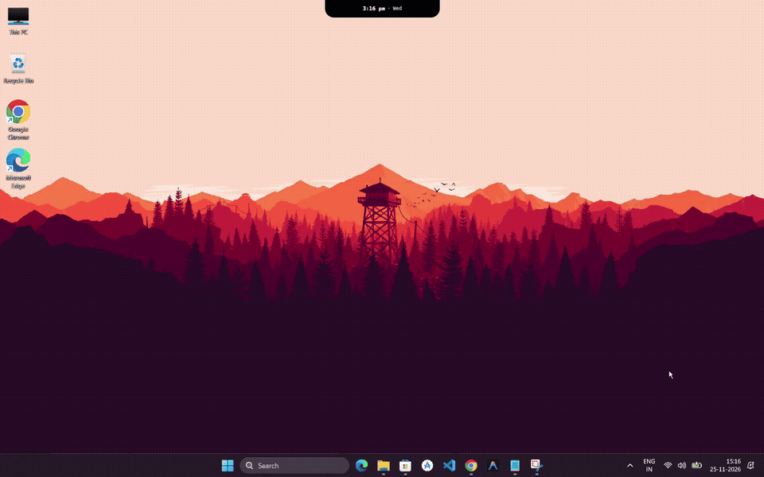
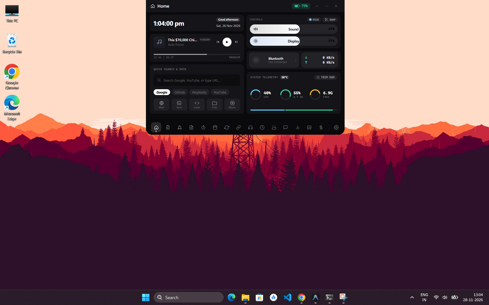
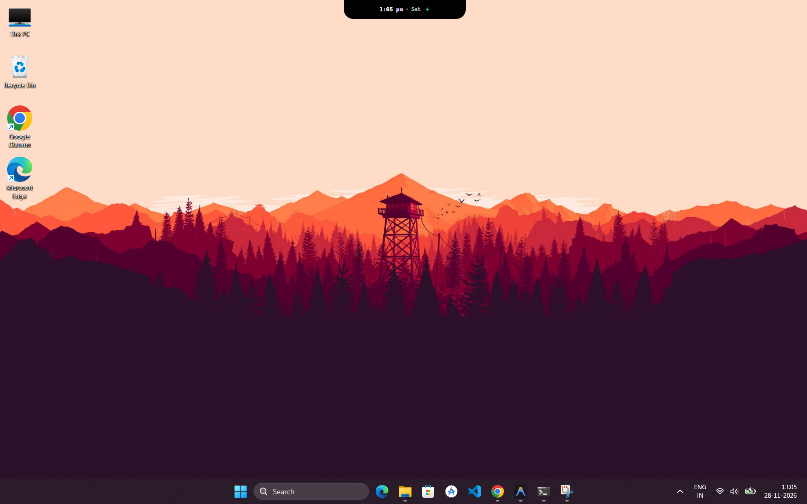
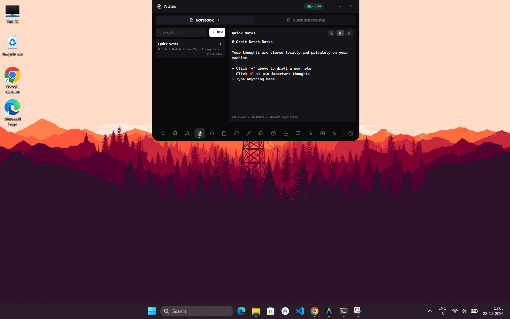
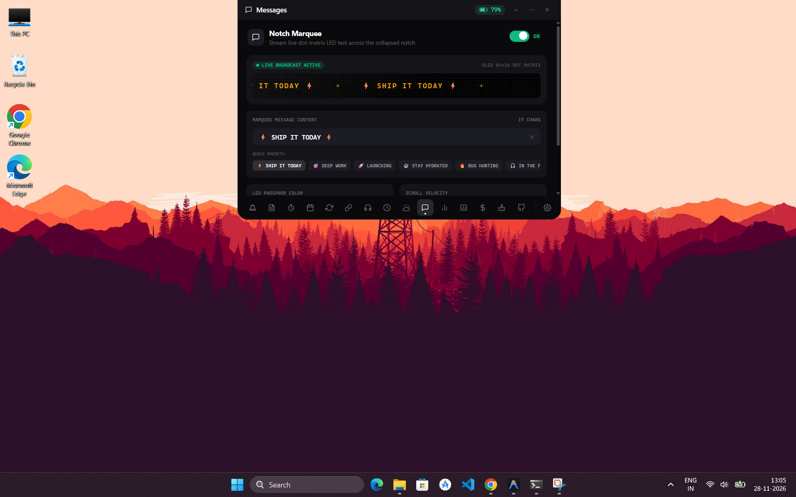

  
  <h1 style="margin-top: 12px; margin-bottom: 4px;">Orbit Notch</h1>
  
<b>The Floating Utility Notch & Universal Quick-Access HUD for Windows</b>

  

    
    
    
    
  

  

    <a href="https://github.com/Kaifazad/Orbit-Notch/releases/latest"><b>Latest v0.2.4 on GitHub</b></a> &nbsp;•&nbsp;
    <a href="https://apps.microsoft.com/detail/9NT7MW2M4R45"><b>Get on Microsoft Store</b></a> &nbsp;•&nbsp;
    <a href="https://orbit-notch.vercel.app/"><b>Official Website</b></a> &nbsp;•&nbsp;
    <a href="#-downloads"><b>Downloads</b></a> &nbsp;•&nbsp;
    <a href="#-features"><b>Features</b></a> &nbsp;•&nbsp;
    <a href="PRIVACY.md"><b>Privacy Policy</b></a>
  

---

## ⚡ What is Orbit Notch?

**Orbit Notch** is an ultra-fast, minimalist floating utility notch and dynamic HUD designed natively for Windows 11 and Windows 10. Built from the ground up with high-performance native Rust and modern Svelte 5, it sits lightly at the top of your screen to elevate your daily workflow without stealing focus or cluttering your screen.

Resting discreetly at the top bezel of your display as an unobtrusive 36px hardware-style digital clock, Orbit Notch expands with smooth spring physics whenever you copy text, grab a screenshot, trigger a reminder, play music, or drag files. With a single click or keyboard shortcut (<kbd>Ctrl</kbd> + <kbd>Space</kbd> or <kbd>Alt</kbd> + <kbd>&#92;</kbd>), it blooms into a productivity dashboard, Fluent Control Center with instant sliders and screen Color Picker, GitHub Activity Hub, system temperatures, custom ambient sounds, and an offline image converter.

---

## 🎬 Live Walkthrough (v0.2.4)

  
  

    
      <a href="https://github.com/Kaifazad/Orbit-Notch/raw/main/assets/latest-version-video.mp4"><b>Watch Full Walkthrough Video (MP4)</b></a>
      &nbsp;•&nbsp;
      <a href="https://orbit-notch.vercel.app/"><b>Try Interactive Web Showcase</b></a>
    
  

---

## 📸 Desktop Previews

<table>
  <tr>
    <td width="50%" align="center">
       
      <b>Home & Fluent Control Center</b> — Instant volume & display brightness sliders, screen Color Picker (PICK), Snip button, Bluetooth status, network throughput, and CPU/RAM/temperature telemetry.
    </td>
    <td width="50%" align="center">
       
      <b>Resting Dynamic Notch</b> — Minimalist 36px live clock with charging indicator, upcoming meeting countdowns, GitHub streak dot, or media titles.
    </td>
  </tr>
  <tr>
    <td width="50%" align="center">
       
      <b>GitHub Activity & Repos</b> — 36-week green-dot contribution heatmap, daily streak metrics, and smooth switcher to searchable public/private repositories.
    </td>
    <td width="50%" align="center">
       
      <b>Quick Notes & Notebook</b> — Distraction-free markdown notes & snippets saved locally in SQLite.
    </td>
  </tr>
  <tr>
    <td width="50%" align="center">
       
      <b>Universal Parking Shelf</b> — Drag and drop files, images, or clipboard items onto the shelf or resting notch while switching apps.
    </td>
    <td width="50%" align="center">
       
      <b>LED Dot-Matrix Marquee</b> — 64×16 OLED text banners streaming across the collapsed notch with adjustable glow and presets.
    </td>
  </tr>
</table>

---

## 📥 Downloads

> **Always get the latest version first on [GitHub Releases](https://github.com/Kaifazad/Orbit-Notch/releases/latest) before Microsoft Store rollout.**

| Method | Type | Best For | Link |
| :--- | :--- | :--- | :--- |
| **Portable x64 Bundle** | `.zip` Archive (`v0.2.4`) | Latest build immediately (extract & run `OrbitNotch.exe`) | [**Download OrbitNotch-v0.2.4.zip**](https://github.com/Kaifazad/Orbit-Notch/releases/latest) |
| **Microsoft Store** | Official Store App | Automatic background updates & verified Store signing | [**Get from Microsoft Store**](https://apps.microsoft.com/detail/9NT7MW2M4R45) |
| **Windows Package Manager** | `winget` | Command-line Store install / upgrade | `winget install --id 9NT7MW2M4R45 -s msstore` |
| **Direct MSIX Package** | `.msix` Container (`v0.2.4`) | Store-ready package container | [**View Releases**](https://github.com/Kaifazad/Orbit-Notch/releases/latest) |

> **System Requirements**: Windows 11 or Windows 10 (64-bit). No administrator elevation required (`asInvoker`).

---

## 🌟 Features

### ⏱️ 1. Clean Live Clock, Charging & Smart Countdowns
- Sits docked at the top bezel showing 12h or 24h time, day, and charging status.
- **Meeting-Soon Pill Countdown**: Upcoming Calendar reminders appear automatically (`in Xm`) on the collapsed pill within 15 minutes of start time.
- **Windows Native Notifications**: Scheduled Calendar reminders fire native Windows toast notifications alongside Dynamic Island alerts.

### 🎛️ 2. Fluent Control Center, Eyedropper & Hardware Telemetry
- **Instant Hardware Sliders**: Non-blocking Display Brightness and Master Volume sliders with immediate drag updates.
- **Quick Color Picker (`PICK`)**: Built-in screen eyedropper that copies `#HEX` codes straight to Clipboard.
- **Bluetooth, Network & Temps**: Live earbud/headphone battery status, download/upload speeds (`IPHLPAPI`), RAM Trim, and zero-driver CPU/GPU temperatures (`°C` / `°F`).

### 🐙 3. GitHub Activity & Streak Pill
- Connect GitHub via read-only token or public username to inspect your **36-week green-dot contribution heatmap**, daily streak, and searchable Public/Private repositories.
- Pin today's green activity dot & streak count directly onto the collapsed notch.

### 📋 4. Clipboard History, Pinning & Offline Converter
- Pin favorite snippets so `CLEAR ALL` keeps them preserved, with character count badges and automatic tracking-link cleaning.
- Park files/images in the **Universal Shelf** and convert images offline between WebP, PNG, JPEG, ICO, BMP, and PDF.

### 🎨 5. Dock Role Presets, Custom Sounds & Privacy
- **Bottom Dock Role Presets**: Switch between Default, Coder, Normal User, Creator / Founder, and Minimal Focus layouts in Settings with Home pinned `#1`.
- **Custom Ambient Audio**: Upload MP3, WebM, WAV, OGG, or FLAC tracks alongside procedural focus soundscapes.
- **100% Private & Local**: Zero telemetry. Data stays locally in `%LOCALAPPDATA%\OrbitNotch\orbitnotch.db`. Auto-Hide Fullscreen & Snipping Tool protection enabled by default.

---

## ⌨️ Shortcuts

| Shortcut | Action |
| :--- | :--- |
| <kbd>Ctrl</kbd> + <kbd>Space</kbd> / <kbd>Alt</kbd> + <kbd>Space</kbd> | Toggle Orbit Notch Shelf & Control Center |
| <kbd>Alt</kbd> + <kbd>&#92;</kbd> | Quick Expand to Home Module |
| <kbd>Alt</kbd> + <kbd>P</kbd> | Open Preferences & Settings |
| <kbd>Alt</kbd> + <kbd>B</kbd> | Toggle Flyout |
| <kbd>Esc</kbd> | Collapse Flyout back into resting notch |

---

## 📄 License & Contact

- **Website**: [https://orbit-notch.vercel.app/](https://orbit-notch.vercel.app/)
- **Microsoft Store**: [https://apps.microsoft.com/detail/9NT7MW2M4R45](https://apps.microsoft.com/detail/9NT7MW2M4R45)
- **Privacy Policy**: Read our [Privacy Policy](PRIVACY.md).
- **Developer**: Kaif Azad ([itzkaifazad@gmail.com](mailto:itzkaifazad@gmail.com)).
